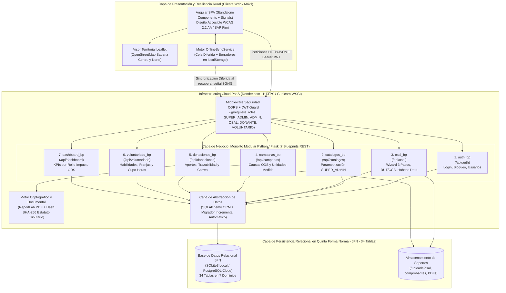
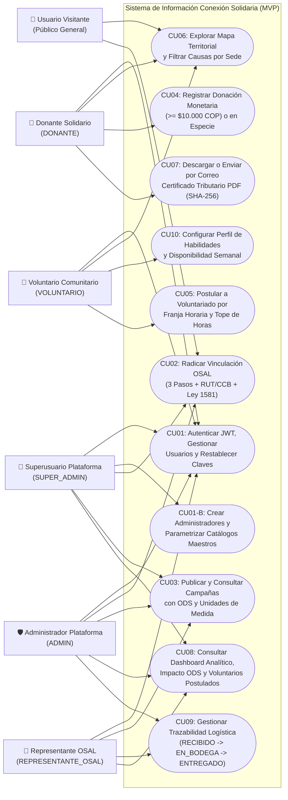
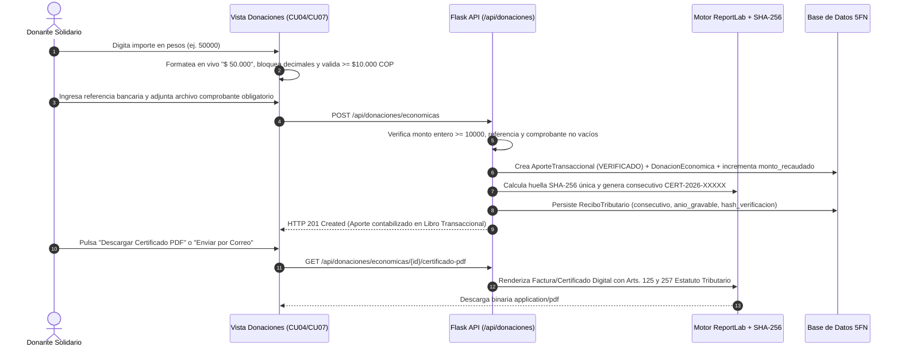
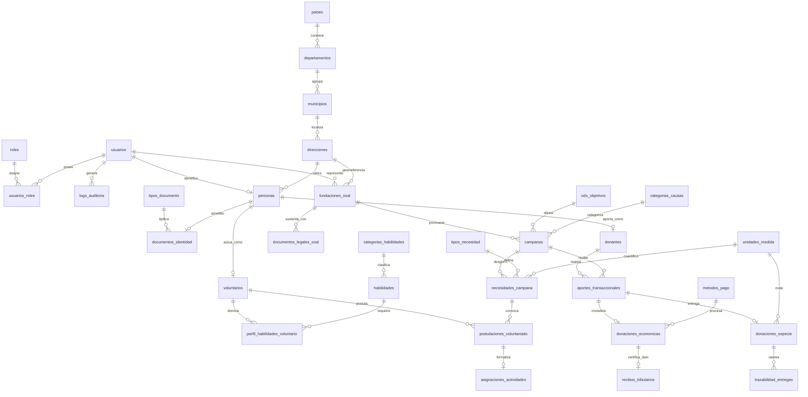

# Borrador 3 (Anexo F): Diagramas de Arquitectura, Casos de Uso, Secuencia RUP y Modelo de Datos en 5FN (34 Tablas)

> **Propósito de este documento:** Constituir el **Anexo F (Diagramas de arquitectura y diseño)** y proveer el contenido técnico completo para los apartados `2.6.1 (Arquitectura de software)`, `2.6.3 / 5.4.3 (Diseño de la base de datos)` y `5.4.2 (Arquitectura tecnológica)` del documento entregable (`conexion_solidaria_v3 (1).docx`).

---

## 1. Diagrama de Arquitectura de Software (*Low-Bandwidth Rural Social Architecture - LBRSA*)

El sistema implementa una arquitectura de **Monolito Modular Desacoplado** desplegado sobre infraestructura Cloud (**Render**), diseñada específicamente para minimizar costos de mantenimiento y garantizar resiliencia operativa en veredas de la Sabana con conectividad móvil intermitente:



---

## 2. Diagrama General de Casos de Uso RUP por Actor

El modelo dinámico del sistema articula los **6 actores** (5 roles autenticados + Visitante) con los **10 Casos de Uso (`CU01` a `CU10`)**:



---

## 3. Diagramas de Secuencia RUP de los Procesos Críticos

### 3.1. Secuencia del Protocolo de Radicación Documental, Habeas Data y Aprobación de OSAL (`CU02` + `CU01`)

```mermaid
sequenceDiagram
    autonumber
    actor Rep as Representante OSAL Rural
    participant Wiz as Wizard Angular (CU02)
    participant Off as OfflineSyncService
    participant API as Flask API (/api/osal)
    participant DB as Base de Datos 5FN
    actor Adm as Administrador (ADMIN / SUPER_ADMIN)

    Rep->>Wiz: Diligencia Paso 1 (NIT, Misión) y Paso 2 (Municipio, Vereda, Representante)
    Wiz->>Off: Guarda avance automático en localStorage
    Rep->>Wiz: Paso 3: Adjunta RUT (DIAN) + Cámara Comercio y acepta Habeas Data (Ley 1581)
    Wiz->>Wiz: Valida presencia obligatoria de 2 archivos y check Ley 1581
    Wiz->>API: POST /api/osal/registro (JSON + Metadatos de Soportes)
    API->>DB: Inserta Direccion, Usuario, Persona, FundacionOsal (PENDIENTE, acepta_tratamiento_datos=True)
    API->>DB: Inserta 2 registros en documentos_legales_osal (EN_REVISION) + LogAuditoria
    API-->>Wiz: HTTP 201 Created (Radicación exitosa + Botón Volver al Inicio)
    
    Adm->>API: GET /api/osal/pendientes (Revisa RUT y Cámara de Comercio)
    Adm->>API: PUT /api/osal/{id}/estado (estado="APROBADA")
    API->>DB: Actualiza FundacionOsal="APROBADA", Documentos="APROBADO" y registra LogAuditoria
    API-->>Adm: HTTP 200 OK (Fundación visible en Mapa y habilitada para crear campañas)
```

---

### 3.2. Secuencia de Donación Monetaria Controlada y Emisión de Certificado Tributario Digital (`CU04` + `CU07`)



---

## 4. Diagrama Entidad-Relación (DER) en Quinta Forma Normal (5FN - 34 Tablas)



---

## 5. Diccionario de Datos Completo de las 34 Tablas en Quinta Forma Normal (5FN)

El esquema relacional consta exactamente de **34 tablas** distribuidas en **7 módulos arquitectónicos**, verificadas mediante introspección directa del motor SQLAlchemy (`inspect(db.engine).get_table_names()`):

### Módulo 1: Seguridad, Control de Acceso (RBAC) y Auditoría (4 Tablas)

| # | Nombre de Tabla (`snake_case`) | Clave Primaria (`PK`) | Claves Foráneas (`FK`) y Restricciones | Atributos Principales y Propósito en 5FN |
| :-: | :--- | :--- | :--- | :--- |
| **1** | `roles` | `id` (INT) | `UQ(codigo)` | `codigo` (`SUPER_ADMIN`, `ADMIN`, `REPRESENTANTE_OSAL`, `DONANTE`, `VOLUNTARIO`), `nombre`, `descripcion`. Catálogo atómico de perfiles de seguridad. |
| **2** | `usuarios` | `id` (INT) | `UQ(correo_electronico)` | `correo_electronico`, `hash_contrasena`, `esta_activo`, `intentos_fallidos`, `acepta_tratamiento_datos` (Ley 1581/2012), `fecha_aceptacion_datos`, `fecha_registro`, `ultimo_acceso`. |
| **3** | `usuarios_roles` | `id` (INT) | `FK(usuario_id -> usuarios.id)`, `FK(rol_id -> roles.id)`, `UQ(usuario_id, rol_id)` | Relación de proyección N:M pura en 5FN que desacopla las credenciales de autenticación de los privilegios asignados. |
| **4** | `logs_auditoria` | `id` (INT) | `FK(usuario_id -> usuarios.id)` | `accion`, `entidad_afectada`, `registro_id`, `detalle`, `direccion_ip`, `fecha_evento`. Bitácora inmutable de eventos críticos y cambios de estado. |

### Módulo 2: Geolocalización Territorial DANE y Coordenadas Veredales (4 Tablas)

| # | Nombre de Tabla (`snake_case`) | Clave Primaria (`PK`) | Claves Foráneas (`FK`) y Restricciones | Atributos Principales y Propósito en 5FN |
| :-: | :--- | :--- | :--- | :--- |
| **5** | `paises` | `id` (INT) | `UQ(codigo_iso)` | `codigo_iso` (`COL`), `nombre` (`Colombia`). Nivel geográfico raíz. |
| **6** | `departamentos` | `id` (INT) | `FK(pais_id -> paises.id)`, `UQ(codigo_dane)` | `codigo_dane` (`25`), `nombre` (`Cundinamarca`). División político-administrativa departamental. |
| **7** | `municipios` | `id` (INT) | `FK(departamento_id -> departamentos.id)`, `UQ(codigo_dane)` | `codigo_dane`, `nombre` (Chía, Cajicá, Zipaquirá, Tabio, Tenjo, Cogua, Sopó, Tocancipá, Gachancipá, Nemocón), `es_sabana_norte`, `latitud_centro`, `longitud_centro`. |
| **8** | `direcciones` | `id` (INT) | `FK(municipio_id -> municipios.id)` | `vereda_o_barrio`, `direccion_fisica`, `indicaciones_rurales`, `latitud`, `longitud`. Entidad espacial que alimenta el visor `Leaflet`. |

### Módulo 3: Perfiles Civiles y Acreditación Jurídica de OSAL (5 Tablas)

| # | Nombre de Tabla (`snake_case`) | Clave Primaria (`PK`) | Claves Foráneas (`FK`) y Restricciones | Atributos Principales y Propósito en 5FN |
| :-: | :--- | :--- | :--- | :--- |
| **9** | `tipos_documento` | `id` (INT) | `UQ(sigla)` | `sigla` (`CC`, `CE`, `NIT`), `nombre`, `aplica_persona_juridica`. Catálogo normativo de identificación. |
| **10** | `personas` | `id` (INT) | `FK(usuario_id -> usuarios.id)`, `FK(direccion_id -> direcciones.id)` | `nombres`, `apellidos`, `telefono_contacto`, `fecha_nacimiento`. Datos civiles separados de las credenciales de acceso. |
| **11** | `documentos_identidad` | `id` (INT) | `FK(persona_id -> personas.id)`, `FK(tipo_documento_id -> tipos_documento.id)`, `UQ(numero_documento)` | `numero_documento`, `fecha_expedicion`. Aísla la identificación legal para prevenir dependencias transitivas. |
| **12** | `fundaciones_osal` | `id` (INT) | `FK(usuario_representante_id -> usuarios.id)`, `FK(direccion_id -> direcciones.id)`, `UQ(nit)` | `nit`, `razon_social`, `sigla`, `mision`, `telefono_institucional`, `estado_validacion` (`PENDIENTE`, `APROBADA`, `RECHAZADA`), `acepta_tratamiento_datos`, `fecha_aceptacion_datos`, `fecha_constitucion`. |
| **13** | `documentos_legales_osal` | `id` (INT) | `FK(fundacion_id -> fundaciones_osal.id)` | `tipo_soporte` (`RUT_DIAN`, `CERTIFICADO_EXISTENCIA_CAMARA`), `nombre_archivo`, `url_archivo`, `estado_revision`, `fecha_carga`. Soportes obligatorios para auditoría. |

### Módulo 4: Voluntariado y Matriz de Competencias Técnicas (4 Tablas)

| # | Nombre de Tabla (`snake_case`) | Clave Primaria (`PK`) | Claves Foráneas (`FK`) y Restricciones | Atributos Principales y Propósito en 5FN |
| :-: | :--- | :--- | :--- | :--- |
| **14** | `voluntarios` | `id` (INT) | `FK(persona_id -> personas.id)` | `disponibilidad_horas_semana` (tope horario semanal), `biografia_corta`, `dispuesto_desplazamiento_rural`, `activo`. |
| **15** | `categorias_habilidades` | `id` (INT) | `UQ(nombre)` | `nombre` (Agroecología, Pedagogía, Logística), `descripcion`. Agrupador taxonómico de talentos. |
| **16** | `habilidades` | `id` (INT) | `FK(categoria_id -> categorias_habilidades.id)` | `nombre` (Manejo de Huertas, Tutoría Escolar, Transporte 4x4, etc.), `descripcion`. |
| **17** | `perfil_habilidades_voluntario` | `id` (INT) | `FK(voluntario_id -> voluntarios.id)`, `FK(habilidad_id -> habilidades.id)`, `UQ(voluntario_id, habilidad_id)` | `nivel_dominio` (`BASICO`, `INTERMEDIO`, `AVANZADO`), `anos_experiencia`. Proyección 5FN de competencias por voluntario. |

### Módulo 5: Catálogo de Causas Sociales y Alineación con los ODS (5 Tablas)

| # | Nombre de Tabla (`snake_case`) | Clave Primaria (`PK`) | Claves Foráneas (`FK`) y Restricciones | Atributos Principales y Propósito en 5FN |
| :-: | :--- | :--- | :--- | :--- |
| **18** | `ods_objetivos` | `id` (INT) | `UQ(numero_ods)` | `numero_ods` (`1, 2, 3, 4, 9, 10, 11, 15, 17`), `titulo`, `descripcion`. Marco internacional de impacto social. |
| **19** | `categorias_causas` | `id` (INT) | `UQ(nombre)` | `nombre` (Soberanía Alimentaria, Educación Veredal, Conservación de Páramos, Bienestar Animal, Adulto Mayor, Cultura), `descripcion`. |
| **20** | `campanas` | `id` (INT) | `FK(fundacion_id -> fundaciones_osal.id)`, `FK(categoria_causa_id -> categorias_causas.id)`, `FK(ods_id -> ods_objetivos.id)` | `titulo`, `descripcion`, `meta_economica`, `monto_recaudado`, `fecha_inicio`, `fecha_fin`, `estado` (`ACTIVA`, `PAUSADA`, `COMPLETADA`). |
| **21** | `tipos_necesidad` | `id` (INT) | `UQ(codigo)` | `codigo` (`ECONOMICA`, `ESPECIE`, `TIEMPO_VOLUNTARIADO`), `nombre`. Clasificador de requerimientos. |
| **22** | `necesidades_campana` | `id` (INT) | `FK(campana_id -> campanas.id)`, `FK(tipo_necesidad_id -> tipos_necesidad.id)`, `FK(unidad_medida_id -> unidades_medida.id)` | `descripcion_item`, `cantidad_requerida`, `cantidad_cubierta`, `prioridad` (`ALTA`, `MEDIA`, `BAJA`). |

### Módulo 6: Transacciones, Logística de Especie y Certificación Tributaria DIAN (8 Tablas)

| # | Nombre de Tabla (`snake_case`) | Clave Primaria (`PK`) | Claves Foráneas (`FK`) y Restricciones | Atributos Principales y Propósito en 5FN |
| :-: | :--- | :--- | :--- | :--- |
| **23** | `donantes` | `id` (INT) | `FK(persona_id -> personas.id)` | `tipo_donante` (`PERSONA_NATURAL`, `EMPRESA`), `empresa_organizacion`, `requiere_certificado_tributario`. |
| **24** | `unidades_medida` | `id` (INT) | `UQ(simbolo)` | `simbolo` (`COP`, `KG`, `LT`, `UND`, `KIT`, `HORAS`), `nombre`. Catálogo de magnitudes físicas y monetarias. |
| **25** | `metodos_pago` | `id` (INT) | `UQ(codigo)` | `codigo` (`TRANSFERENCIA`, `BILLETERA_MOVIL`), `nombre`. Medios de pago habilitados. |
| **26** | `aportes_transaccionales` | `id` (INT) | `FK(donante_id -> donantes.id)`, `FK(campana_id -> campanas.id)`, `UQ(codigo_referencia)` | `codigo_referencia`, `modalidad` (`ECONOMICA`, `ESPECIE`), `estado_aporte` (`REPORTADO`, `VERIFICADO`, `RECHAZADO`), `url_comprobante`, `observaciones`, `fecha_aporte`. |
| **27** | `donaciones_economicas` | `id` (INT) | `FK(aporte_id -> aportes_transaccionales.id)`, `FK(metodo_pago_id -> metodos_pago.id)` | `monto` (entero `>= $10.000 COP`), `moneda` (`COP`), `referencia_bancaria`. Subtipo especializado 5FN para aportes monetarios. |
| **28** | `donaciones_especie` | `id` (INT) | `FK(aporte_id -> aportes_transaccionales.id)`, `FK(unidad_medida_id -> unidades_medida.id)` | `descripcion_articulos`, `cantidad`, `estado_logistico_actual` (`RECIBIDO`, `EN_BODEGA`, `ENTREGADO`). Subtipo especializado 5FN para insumos físicos. |
| **29** | `trazabilidad_entregas` | `id` (INT) | `FK(donacion_especie_id -> donaciones_especie.id)` | `estado_logistico`, `ubicacion_reportada`, `observacion`, `fecha_actualizacion`. Historial de cadena de custodia rural. |
| **30** | `recibos_tributarios` | `id` (INT) | `FK(donacion_economica_id -> donaciones_economicas.id)`, `UQ(numero_consecutivo)`, `UQ(hash_verificacion)` | `numero_consecutivo`, `anio_gravable`, `hash_verificacion` (SHA-256), `enviado_correo`, `correo_destino`, `fecha_envio_correo`, `fecha_emision`. |

### Módulo 7: Asignaciones Operativas y Parametrización Maestra del Sistema (4 Tablas)

| # | Nombre de Tabla (`snake_case`) | Clave Primaria (`PK`) | Claves Foráneas (`FK`) y Restricciones | Atributos Principales y Propósito en 5FN |
| :-: | :--- | :--- | :--- | :--- |
| **31** | `franjas_horarias` | `id` (INT) | `UQ(codigo)` | `codigo`, `nombre` (ej. Fines de semana mañana 7:00 a.m. - 12:00 m.), `horas_sugeridas`, `activa`. Catálogo desplegable para voluntariado. |
| **32** | `parametros_sistema` | `id` (INT) | `UQ(clave)` | `clave` (`MONTO_MINIMO_DONACION_COP`, `MAX_INTENTOS_LOGIN`, `NORMA_TRIBUTARIA_VIGENTE`, `POLITICA_HABEAS_DATA_LEY_1581`, `CORREO_SOPORTE_PLATAFORMA`), `valor`, `descripcion`, `tipo_dato`. |
| **33** | `postulaciones_voluntariado` | `id` (INT) | `FK(voluntario_id -> voluntarios.id)`, `FK(necesidad_campana_id -> necesidades_campana.id)`, `UQ(voluntario_id, necesidad_campana_id)` | `motivacion`, `disponibilidad_propuesta`, `estado_postulacion` (`POSTULADO`, `ACEPTADO`, `RECHAZADO`), `fecha_postulacion`. Impide duplicidad de postulaciones. |
| **34** | `asignaciones_actividades` | `id` (INT) | `FK(postulacion_id -> postulaciones_voluntariado.id)` | `tarea_especifica`, `horas_comprometidas`, `horas_cumplidas`, `estado_actividad` (`ASIGNADA`, `EN_CURSO`, `FINALIZADA`), `fecha_asignacion`. |

