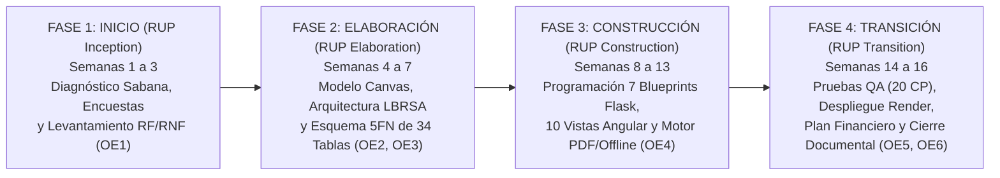

# Borrador 6 (Anexos H, K y L): Guía de Capturas del MVP, Cronograma de Implementación RUP y Manual Operativo del Servicio

> **Propósito de este documento:** Estructurar los **Anexos H (Capturas de pantalla del MVP)**, **Anexo K (Cronograma de implementación)** y **Anexo L (Otros soportes pertinentes)**, articulando explícitamente cómo el software soporta la **Operación del Negocio (Apartado 5.2 Plan Operativo)** y el **Plan de Implementación (Apartado 5.8)** exigidos por los evaluadores.

---

## 1. Articulación Software ↔ Operación del Servicio (Insumo para el Apartado `5.2. Plan Operativo`)

*(Responde a la observación de los evaluadores: "Aunque el documento presenta elementos relacionados con el software, no desarrolla suficientemente el servicio que se ofrecería a través del emprendimiento ni explica cómo se articularía la solución tecnológica con la operación del negocio").*

La operación de **Conexión Solidaria** como fundación de base tecnològica se ejecuta a través de **siete (7) procesos operativos estandarizados**, en los cuales el equipo humano del emprendimiento y la plataforma tecnológica actúan de forma sincronizada:

| Subapartado del Documento | Proceso Operativo del Servicio | Rol del Equipo de Conexión Solidaria (Operación Humana) | Soporte en la Plataforma Tecnológica (Módulo MVP y Tablas 5FN) | SLA / Tiempo de Respuesta Operativo |
| :--- | :--- | :--- | :--- | :--- |
| **5.2.1.** | **Procesos generales de prestación del servicio** | Articulación regional con alcaldías, juntas de acción comunal (JAC) y universidades de la Sabana para identificar OSAL rurales y vincularlas gratuitamente. | Portal público accesible 24/7 con directorio georreferenciado (`/mapa`) y catálogo regional de causas (`/campanas`). | Disponibilidad de plataforma `>= 99,5%` |
| **5.2.2.** | **Registro y validación jurídica de organizaciones** | El comité de gobernanza (`ADMIN`) verifica ante DIAN y Cámara de Comercio la autenticidad del RUT, el Certificado de Existencia y el objeto social rural antes de autorizar la cuenta. | Wizard de 3 pasos (`/registro-osal`) con exigencia técnica de los 2 soportes PDF y Ley 1581, y bandeja de aprobación en `/panel` (`PUT /api/osal/<id>/estado-validacion`). | Revisión y activación en `< 48 horas hábiles` |
| **5.2.3.** | **Gestión de necesidades y campañas** | Acompañamiento a los líderes de las OSAL para estructurar metas realistas, clasificar su aporte a los ODS y cuantificar insumos por unidad de medida. | Módulo `/campanas` con asociación a los 9 ODS prioritarios y desglose de requerimientos en `COP`, `KG`, `LT`, `UND`, `KIT` y `HORAS`. | Publicación inmediata para OSAL `APROBADA` |
| **5.2.4.** | **Gestión y coordinación de voluntariado** | Articulación con oficinas de proyección social universitaria para convocar voluntarios y verificar el cumplimiento de jornadas en campo. | Módulos `/perfil-habilidades` y `/voluntariado` con selección de franjas horarias (`franjas_horarias`), tope de horas semanales y directorio exclusivo en `/dashboard`. | Asignación automática en tiempo real |
| **5.2.5.** | **Gestión de donaciones y transparencia tributaria** | Auditoría de referencias bancarias, acompañamiento contable en Régimen Tributario Especial (RTE) y seguimiento a entregas físicas en veredas. | Módulos `/donaciones` y `/trazabilidad`: validación `>= $10.000 COP`, generación de Certificado Tributario PDF (`ReportLab` + SHA-256 + Arts. 125/257 E.T.), envío por correo y logística en 3 estados. | Emisión de certificado en `< 3 segundos` |
| **5.2.6.** | **Atención y acompañamiento a usuarios rurales** | Brigadas presenciales de alfabetización digital en veredas y mesa de ayuda por correo (`gobernanza@conexionsolidaria.org`) y WhatsApp institucional. | Asistentes guiados paso a paso, alertas semánticas en lenguaje claro y restablecimiento administrativo de contraseñas bloqueadas en `/panel`. | Atención de soporte en `< 24 horas` |
| **5.2.7.** | **Mantenimiento, gobierno y soporte tecnológico** | Monitoreo de servidores en Render, copias de seguridad de PostgreSQL y actualización de parámetros normativos o nuevos municipios sin detener el servicio. | Consola exclusiva de **Superusuario (`SUPER_ADMIN`)** en `/panel` para administrar `parametros_sistema`, `unidades_medida`, `franjas_horarias`, `habilidades` y cuentas `ADMIN`. | Despliegue continuo sin caída (*Zero-downtime*) |

---

## 2. Anexo H: Catálogo Estructurado de Capturas de Pantalla del MVP

Para la incorporación visual en el **Anexo H** del documento final (`.docx`), el MVP cuenta con **12 vistas verificables en ejecución (`http://localhost:4200`)** que documentan la totalidad de los casos de uso:

| # Figura | Título de la Figura para el Anexo H | Ruta / Vista en la Aplicación | Elementos Técnicos que Demuestra la Captura |
| :-: | :--- | :--- | :--- |
| **Fig. H-01** | **Visor Georreferenciado de la Sabana y Directorio Territorial (`CU06`)** | `http://localhost:4200/mapa` | Mapa interactivo `Leaflet` con pines en Cogua, Chía, Cajicá, Zipaquirá y Tabio, filtro por municipio y tarjetas de las 5 fundaciones caracterizadas con botón *"Ver causas de esta fundación"*. |
| **Fig. H-02** | **Catálogo de Causas Filtrado por Fundación con Retorno Contextual (`CU03/CU06`)** | `http://localhost:4200/campanas?fundacion_id=1` | Encabezado contextual filtrando exclusivamente las causas de la fundación seleccionada desde el mapa, botón *"← Volver al Visor Georreferenciado"*, barra de progreso presupuestal y etiquetas de unidades (`KIT`, `HORAS`, `KG`, `UND`). |
| **Fig. H-03** | **Formulario de Publicación de Campañas con ODS y Unidades de Medida (`CU03`)** | `http://localhost:4200/campanas` *(Sección publicar)* | Selección de los 9 ODS (`ODS 1, 2, 3, 4, 9, 10, 11, 15, 17`), categoría social y selector de **Unidad de Medida (`COP`, `KG`, `LT`, `UND`, `KIT`, `HORAS`)** por cada requerimiento. |
| **Fig. H-04** | **Asistente (Wizard) de Vinculación de OSAL — Pasos 1 y 2 (`CU02`)** | `http://localhost:4200/registro-osal` | Registro de NIT, razón social, misión rural, selección de municipio con carga automática de coordenadas geográficas, vereda y datos del representante legal, con aviso de autoguardado `OfflineSyncService`. |
| **Fig. H-05** | **Wizard OSAL — Paso 3: Soportes Obligatorios RUT/Cámara y Habeas Data Ley 1581 (`CU02`)** | `http://localhost:4200/registro-osal` *(Etapa 3)* | Controles obligatorios para adjuntar el **RUT (DIAN)** y el **Certificado de Existencia y Representación Legal**, junto con la casilla obligatoria de **Autorización de Tratamiento de Datos (Ley 1581 de 2012)** y botón de finalización post-radicación. |
| **Fig. H-06** | **Acceso Seguro y Selección Rápida de los 5 Roles RBAC (`CU01`)** | `http://localhost:4200/login` | Formulario de autenticación JWT y botones demostrativos para los 5 perfiles (`Superusuario`, `Administrador`, `Representante OSAL`, `Donante` y `Voluntario`). |
| **Fig. H-07** | **Vista Principal de Bienvenida y Resumen Ejecutivo del Usuario (`CU01/CU10`)** | `http://localhost:4200/panel` *(Rol Voluntario / Donante)* | Ficha ejecutiva que aparece inmediatamente al iniciar sesión mostrando disponibilidad horaria, horas comprometidas, habilidades certificadas y tabla de postulaciones o donaciones propias. |
| **Fig. H-08** | **Postulación a Voluntariado con Franja Desplegable y Control de Horas (`CU05`)** | `http://localhost:4200/voluntariado` | Lista desplegable de **Franja Horaria Propuesta**, validación de tope máximo de horas según perfil, alerta en **verde** para postulación exitosa (con botón de finalizar), alerta en **rojo** para postulación duplicada y tabla filtrada solo para el usuario actual. |
| **Fig. H-09** | **Registro de Donaciones con Separador de Miles y Comprobante Obligatorio (`CU04`)** | `http://localhost:4200/donaciones` | Campo de importe en pesos con formato automático de miles (`50.000`), restricción de monto mínimo `$10.000 COP` sin decimales, carga obligatoria de comprobante digital y Libro Mayor de Transacciones con botones **"Descargar Certificado PDF"** y **"Enviar por Correo"**. |
| **Fig. H-10** | **Certificado Tributario Digital / Comprobante Fiscal PDF (`CU07`)** | `/api/donaciones/economicas/1/certificado-pdf` | Documento PDF generado por `ReportLab` con diseño de factura/comprobante fiscal, datos del emisor OSAL y donante, liquidación en `$ COP`, bloque normativo expreso (**Arts. 125, 125-1, 125-2, 125-3 y 257 del Estatuto Tributario y Decreto 2150 de 2017**) y huella **SHA-256**. |
| **Fig. H-11** | **Tablero de Control Analítico (Dashboard OSAL), Impacto ODS y Voluntarios Postulados (`CU08`)** | `http://localhost:4200/dashboard` | Tarjetas KPI (incluyendo Tasa de Cobertura de Necesidades %), bloque de **Indicadores de Validación de Impacto por ODS** y **Directorio de Voluntarios Postulados a Nuestras Causas** (visible para la OSAL y administradores). |
| **Fig. H-12** | **Consola de Superusuario (`SUPER_ADMIN`): Gestión de Usuarios y Parametrización Maestra (`CU01`)** | `http://localhost:4200/panel` *(Rol Superusuario)* | Creación de cuentas `ADMIN`, restablecimiento de contraseñas/desbloqueo de usuarios y formularios de parametrización global de Unidades de Medida, Franjas Horarias, Categorías, Habilidades y Parámetros del Sistema (`parametros_sistema`). |

---

## 3. Anexo K: Cronograma de Implementación por Fases RUP y Puesta en Marcha del Emprendimiento (`Apartado 5.8.2`)

El cronograma articula las **4 fases de la metodología RUP** con los **6 objetivos específicos** del proyecto a lo largo de **16 semanas (4 meses)** para la formulación y construcción del MVP, seguido de las fases de despliegue piloto y expansión regional:

### Matriz Cronológica Detallada por Fase, Actividad y Entregable Verificable

| Fase Metodológica (RUP + Emprendimiento) | Objetivo Específico | Actividad Ejecutada | Semanas (S1–S16) | Entregable / Evidencia Verificable |
| :--- | :---: | :--- | :---: | :--- |
| **Fase 1: Inicio (*Inception*)** | **OE1** | 1.1. Caracterización de OSAL rurales en Sabana Centro y Norte y diseño de instrumentos (Encuestas 1 y 2). | `S1 – S2` | Capítulo 3, Anexo A, Anexo B y Anexo C. |
| **Fase 1: Inicio (*Inception*)** | **OE1** | 1.2. Identificación de los 6 perfiles de usuario (RBAC) y especificación de requerimientos `RF01–RF12` y `RNF01–RNF06`. | `S2 – S3` | Matriz de Requerimientos y RBAC (Anexo E). |
| **Fase 2: Elaboración (*Elaboration*)** | **OE2** | 2.1. Análisis competitivo, definición de propuesta de valor y estructuración de los 9 bloques del Modelo Canvas. | `S4 – S5` | Capítulo 4 (Modelo de Negocio Canvas). |
| **Fase 2: Elaboración (*Elaboration*)** | **OE3** | 2.2. Diseño de la Arquitectura Resiliente (`LBRSA`), diagramas de casos de uso/secuencia RUP y prototipos UI/UX accesibles. | `S5 – S6` | Diagramas de Arquitectura y Diseño (Anexo F). |
| **Fase 2: Elaboración (*Elaboration*)** | **OE3** | 2.3. Modelado relacional normalizado hasta **Quinta Forma Normal (5FN)** con **34 tablas** en 7 dominios y diccionario de datos. | `S6 – S7` | Script ORM [`models/__init__.py`](file:///c:/Users/ingor/conexion-solidaria/backend/app/models/__init__.py) y Diccionario 5FN (Anexo F). |
| **Fase 3: Construcción (*Construction*)** | **OE4** | 3.1. Implementación del Backend modular en Python/Flask (`auth`, `catalogos`, `osal`, `campanas`, `donaciones`, `voluntariado`, `dashboard`). | `S8 – S10` | Código fuente Backend y decorador `@requiere_roles` (Anexo G). |
| **Fase 3: Construcción (*Construction*)** | **OE4** | 3.2. Implementación del generador de Certificados Tributarios PDF (`ReportLab` + SHA-256 + Estatuto Tributario) y motor `OfflineSyncService`. | `S10 – S11` | Módulo `donaciones.py` y servicio `offline-sync.service.ts` (Anexo G). |
| **Fase 3: Construcción (*Construction*)** | **OE4** | 3.3. Construcción de las 10 vistas SPA en Angular Standalone, visor georreferenciado `Leaflet` y consola de Superusuario (`SUPER_ADMIN`). | `S11 – S13` | Código fuente Frontend compilado y Vistas del MVP (Anexo H). |
| **Fase 4: Transición (*Transition*)** | **OE5** | 4.1. Ejecución de pruebas de caja negra, integración, validación de reglas de negocio (`CP-01` a `CP-15`) y medición de latencia en red rural. | `S14 – S15` | Matriz de Pruebas QA y Estudio de Viabilidad Técnica (Anexo I). |
| **Fase 4: Transición (*Transition*)** | **OE6** | 4.2. Estructuración del plan organizacional, jurídico, operativo, marketing, costeo Cloud, flujo financiero, matriz de riesgos y despliegue en Render. | `S15 – S16` | Capítulo 5, `render.yaml`, Anexo J, Anexo K y Anexo L. |

---

## 4. Anexo L: Soportes Técnicos Pertinentes (Estructura del Certificado Tributario Digital y Despliegue Cloud)

### 4.1. Especificación Legal y Técnica del Certificado Digital de Donación (`CU07`)

Cada certificado emitido por la plataforma mediante el endpoint `GET /api/donaciones/economicas/<id>/certificado-pdf` cumple la estructura formal de un **Comprobante Fiscal Digital de Donación** para Entidades Sin Ánimo de Lucro pertenecientes al **Régimen Tributario Especial (RTE)**:

1. **Encabezado Fiscal y Consecutivo Único:** Membrete institucional de Conexión Solidaria Sabana, número de serie único (`CERT-2026-XXXXXX`), año gravable, fecha exacta de emisión UTC y estado fiscal `VERIFICADO Y CONTABILIZADO`.
2. **Sección I — Entidad Beneficiaria Receptora (OSAL):** Razón social, sigla, NIT verificado, jurisdicción municipal/veredal, teléfono institucional y calificación en el Régimen Tributario Especial.
3. **Sección II — Identificación del Donante / Contribuyente:** Nombres y apellidos o razón social empresarial, tipo y número de documento de identidad (`CC`, `CE`, `NIT`), modalidad del donante y correo electrónico registrado.
4. **Sección III — Liquidación y Detalle Transaccional:** Código de referencia interna (`DON-ECO-XXXXXX`), campaña social y ODS impactado, medio de pago (`Transferencia Bancaria / PSE` o `Billetera Móvil`), número de comprobante bancario, archivo soporte auditado e **importe total certificado en pesos colombianos (`$ COP` sin decimales)**.
5. **Sección IV — Declaración Normativa Expresa:**
   > *"La entidad beneficiaria certifica bajo la gravedad de juramento que los recursos descritos fueron recibidos de forma efectiva y se destinan exclusivamente al desarrollo de su objeto social meritorio en la Sabana de Cundinamarca. El presente certificado se expide en cumplimiento de los **Artículos 125, 125-1, 125-2, 125-3 y 257 del Estatuto Tributario Nacional**, el **Decreto Reglamentario 2150 de 2017** y demás normas concordantes de la Dirección de Impuestos y Aduanas Nacionales (DIAN), otorgando derecho al descuento tributario sobre el impuesto sobre la renta y complementarios equivalente al 25% del valor donado en el año o período gravable."*
6. **Sección V — Sello Criptográfico de Integridad:** Huella digital **SHA-256** de 64 caracteres hexadecimales generada a partir de los metadatos inmutables de la transacción y firmas digitales del Representante Legal / Contador Público de la OSAL y de la plataforma de auditoría.

### 4.2. Configuración de Despliegue Continuo en la Nube (`render.yaml`)

El repositorio cuenta en su raíz con la especificación de Infraestructura como Código ([`render.yaml`](file:///c:/Users/ingor/conexion-solidaria/render.yaml)) que automatiza la compilación de Angular, la instalación de dependencias de Python, la creación/migración de las 34 tablas en 5FN y la puesta en producción bajo servidor WSGI `Gunicorn`.

